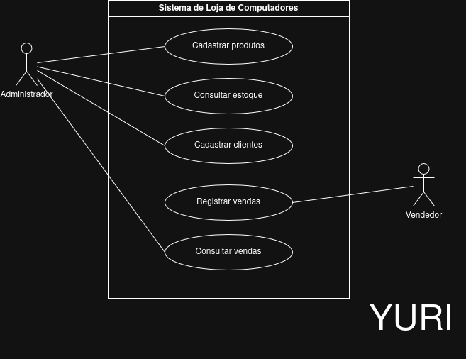

    # 4.2.2 Modelagem de Casos de Uso

## Atores

O sistema da loja de computadores possui dois atores principais. O ator representa o papel desempenhado pelo usuário ao interagir com o sistema.

| Ator | Quem é | O que faz no sistema |
|---|---|---|
| Administrador | Gerente ou proprietário da loja | Cadastra produtos, clientes e consulta o histórico de vendas e o estoque. |
| Vendedor | Funcionário responsável pelas vendas | Realiza o registro de vendas de produtos para os clientes. |

## Casos de uso

A lista de casos de uso deriva dos requisitos funcionais (RF01 a RF06) definidos na seção 4.2.1. O RF06 (Atualizar estoque) é executado automaticamente pelo sistema durante o registro da venda e não possui ator direto.

| Caso de uso | Ator | Atende |
|---|---|---|
| Cadastrar produtos | Administrador | RF01 |
| Consultar estoque | Administrador | RF02 |
| Cadastrar clientes | Administrador | RF03 |
| Registrar vendas | Vendedor | RF04 e RF06 (atualização de estoque no passo 5) |
| Consultar vendas | Administrador | RF05 |

## Diagrama de casos de uso

**Figura 1 – Diagrama de casos de uso do Sistema de Loja de Computadores**

Fonte: Autoria própria (2026).

A Figura 1 apresenta a fronteira do sistema com os atores Administrador e Vendedor situados do lado externo. O Administrador está associado aos casos de uso Cadastrar produtos, Consultar estoque, Cadastrar clientes e Consultar vendas. O Vendedor está associado ao caso de uso Registrar vendas. Todas as conexões são representadas por linhas contínuas sem ponta de seta.

## Especificação do caso de uso principal

O caso de uso **Registrar vendas** é o principal da loja de computadores, pois garante a concretização do negócio e a movimentação automática do estoque de periféricos e peças.

| Campo | |
|---|---|
| Caso de uso | Registrar vendas |
| Ator | Vendedor |
| Pré-condição | O vendedor estar autenticado no sistema, os produtos informados e o cliente estarem previamente cadastrados no banco de dados (RF01 e RF03). |
| Pós-condição | A venda é registrada com sucesso no histórico e a quantidade dos produtos vendidos é deduzida automaticamente do estoque (RF06). |

**Fluxo principal**

1. O vendedor informa o identificador (CPF ou código) do cliente.
2. O sistema valida o cadastro e exibe os dados do cliente.
3. O vendedor seleciona o produto desejado e informa a quantidade.
4. O sistema confirma que a quantidade informada do produto está disponível em estoque.
5. O sistema adiciona o item, calcula o valor total da venda e atualiza a quantidade em estoque (RF06).
6. O vendedor confirma a finalização da venda.
7. O sistema registra a transação e exibe o comprovante da venda.

**Fluxo alternativo**

- **A1, no passo 2: O cliente não está cadastrado.** O sistema exibe um aviso. O vendedor direciona o cliente ao administrador para efetuar o cadastro (Cadastrar clientes, RF03) e o fluxo retorna ao passo 1.

**Fluxos de exceção**

- **E1, no passo 4: Quantidade do produto insuficiente em estoque.** O sistema exibe uma mensagem informando que a quantidade solicitada não está disponível no estoque atual. O registro da venda é cancelado e o sistema não altera o estoque.

## Rastreabilidade com a 4.2.1

| Requisito | Caso de uso | Onde aparece |
|---|---|---|
| RF01 Cadastrar produtos | Cadastrar produtos | Elipse no diagrama e pré-condição de Registrar vendas |
| RF02 Consultar estoque | Consultar estoque | Elipse no diagrama |
| RF03 Cadastrar clientes | Cadastrar clientes | Elipse no diagrama e fluxo alternativo A1 |
| RF04 Registrar vendas | Registrar vendas | Elipse no diagrama e especificação principal |
| RF05 Consultar vendas | Consultar vendas | Elipse no diagrama |
| RF06 Atualizar estoque | Nenhuma elipse direta | Passo 5 e pós-condição do caso de uso Registrar vendas |

**Todo requisito tem lugar?** Sim. Os requisitos de RF01 a RF05 possuem elipses diretas no diagrama. O RF06 (Atualizar estoque) é atendido como uma ação interna executada no passo 5 do fluxo principal de Registrar vendas.

**Toda elipse tem requisito?** Sim. Cada caso de uso representado por uma elipse no diagrama atende exatamente a um requisito funcional definido na 4.2.1.

**O que a especificação mudou?** A especificação evidenciou a necessidade de checar a disponibilidade do estoque antes de confirmar o item (tratada na exceção E1) e a dependência do cadastro do cliente antes da venda (tratada no alternativo A1).