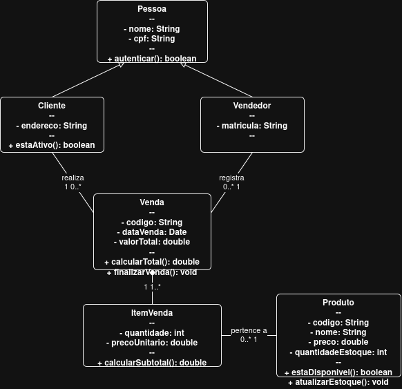

# 4.2.3 Classes: do passo a passo às classes

## 1. Dos substantivos às classes

A análise dos substantivos foi realizada a partir do fluxo principal do Caso de Uso **UC01: Realizar Venda de Computadores e Peças** (seção 4.2.2) e dos Requisitos Funcionais **RF01 a RF05** (seção 4.2.1) do sistema da loja de computadores.

| Substantivo Identificado | Decisão | Justificativa |
| :--- | :--- | :--- |
| **Cliente** | Classe | Entidade principal com dados cadastrais (nome, CPF/CNPJ, e-mail) e histórico de compras. |
| **Produto** | Classe | Classe abstrata/geral que representa qualquer item do estoque (computadores, periféricos, peças). |
| **Computador** | Classe | Classe concreta (especialização de Produto) para montagens completas com especificações técnicas. |
| **Peca** | Classe | Classe concreta (especialização de Produto) para componentes individuais (RAM, GPU, Processador). |
| **Pedido** | Classe | Entidade central que registra a compra, valor total, status e itens adquiridos. |
| **ItemPedido** | Classe | Entidade associativa que conecta o Pedido ao Produto, armazenando quantidade e preço unitário. |
| **Preço / Estoque** | Atributos | Propriedades da classe Produto (`preco: double`, `quantidadeEstoque: int`). |
| **Sistema / Loja** | Descartado | Representa a fronteira da aplicação e o ambiente de negócio, não uma classe do domínio. |

---

## 2. Classes

Tabela detalhada contendo o nome das classes, seus atributos, operações e a origem de cada elemento no sistema da loja de computadores.

| Nome da Classe | Atributos (`nome: tipo`) | Operações (`operacao(): tipo`) | Origem |
| :--- | :--- | :--- | :--- |
| **Cliente** | `- id: int` `- nome: String` `- cpfCnpj: String` `- email: String` | `+ cadastrar(): boolean` `+ consultarHistoricoPedidos(): List<Pedido>` | RF01 / UC01 |
| **Produto** *(Abstrata)* | `- id: int` `- nome: String` `- preco: double` `- quantidadeEstoque: int` | `+ atualizarEstoque(qtd: int): void` `+ consultarPreco(): double` | RF02 / UC01 |
| **Computador** | `- processador: String` `- memoriaRam: String` `- armazenamento: String` `- placaDeVideo: String` | `+ validarCompatibilidade(): boolean` | RF02 / UC01 |
| **Peca** | `- categoria: String` `- fabricante: String` `- numeroSerie: String` | `+ verificarGarantia(): boolean` | RF02 / UC01 |
| **Pedido** | `- id: int` `- dataCriacao: DateTime` `- status: String` `- valorTotal: double` | `+ adicionarItem(item: ItemPedido): void` `- calcularTotal(): double` `+ fecharPedido(): boolean` | RF03 / UC01 |
| **ItemPedido** | `- quantidade: int` `- precoUnitario: double` | `+ calcularSubtotal(): double` | RF03 / UC01 |

---

## 3. Diagrama de classes

*Figura 1: Diagrama de Classes da Loja de Computadores.*
*Fonte: Os autores.*

### Descrição do Diagrama

O diagrama de classes acima descreve a estrutura estática do sistema da loja de computadores:
* **Cliente - Pedido:** Associação de 1 para N ($1 .. *$). Um cliente pode realizar zero ou vários pedidos, mas cada pedido pertence a apenas um único cliente.
* **Pedido - ItemPedido:** Composição de 1 para N ($1 .. *$). Um pedido possui um ou mais itens. O `ItemPedido` não existe de forma independente do `Pedido` (forte vínculo de vida).
* **ItemPedido - Produto:** Associação de N para 1 ($* .. 1$). Cada linha de item de pedido se refere a exatamente um produto do catálogo (seja uma peça individual ou um computador montado).
* **Herança (Produto -> Computador / Peca):** A classe abstrata `Produto` é especializada em duas sub-classes concretas (`Computador` e `Peca`), aplicando o conceito de herança para reutilizar atributos comuns como preço e controle de estoque, enquanto isola especificações técnicas e regras de compatibilidade.

---

## 4. Teste de objetos

**Cenário Real:** O cliente *Lucas Mendes* acessa o sistema para comprar 1 Computador Gamer montado e 2 Pentes de Memória RAM de 16GB.

| Objeto Concreto | Classe | Atributos e Valores |
| :--- | :--- | :--- |
| `cliente1` | `Cliente` | `id = 101`, `nome = "Lucas Mendes"`, `cpfCnpj = "123.456.789-00"`, `email = "lucas@email.com"` |
| `computador1` | `Computador` | `id = 501`, `nome = "PC Gamer RTX 4060"`, `preco = 4500.00`, `quantidadeEstoque = 5`, `processador = "Intel i7"`, `memoriaRam = "16GB"`, `armazenamento = "SSD 1TB"`, `placaDeVideo = "RTX 4060"` |
| `peca1` | `Peca` | `id = 802`, `nome = "Memória DDR5 16GB"`, `preco = 350.00`, `quantidadeEstoque = 20`, `categoria = "Memória RAM"`, `fabricante = "Corsair"`, `numeroSerie = "MEM5582"` |
| `pedido1` | `Pedido` | `id = 9001`, `dataCriacao = "2026-10-26 14:30"`, `status = "Em Processamento"`, `valorTotal = 5200.00` |
| `item1` | `ItemPedido` | `quantidade = 1`, `precoUnitario = 4500.00` (referente ao `computador1`) |
| `item2` | `ItemPedido` | `quantidade = 2`, `precoUnitario = 350.00` (referente à `peca1`) |

### Verificação do Teste
1. **Atributos:** A estrutura de atributos comportou perfeitamente os produtos complexos (PC montado) e produtos simples (peças individuais).
2. **Cálculo do Pedido:** O método `calcularSubtotal()` dos itens somado ($4500.00 + (2 \times 350.00) = 5200.00$) permitiu ao `pedido1` calcular o `valorTotal` correto.
3. **Relacionamentos:** A estrutura reduziu o risco de inconsistências de estoque ao vincular corretamente as vendas.

---

## 5. Rastreabilidade com a 4.2.2

Tabela de verificação relacionando os elementos do diagrama ao fluxo do Caso de Uso **UC01** e aos Requisitos Funcionais.

| Elemento da Classe | Tipo | Origem (Passo do UC / RF) | Resposta às Perguntas de Verificação |
| :--- | :--- | :--- | :--- |
| `Pedido.adicionarItem()` | Operação | UC01 - Passo 2 (Adicionar produto ao carrinho) | **Existe no UC?** Sim. Executada sempre que o cliente escolhe uma peça ou PC. |
| `Produto.atualizarEstoque()` | Operação | UC01 - Passo 5 (Confirmar pagamento) | **Existe no UC?** Sim. Chamada após a aprovação para dar baixa no estoque. |
| `Computador.validarCompatibilidade()`| Operação | UC01 - Passo 3 (Personalizar/Montar PC) | **Existe no UC?** Sim. Garante que as peças escolhidas funcionem juntas. |
| `Cliente.cpfCnpj` | Atributo | RF01 (Cadastro e Faturamento) | **Existe no UC?** Sim. Obrigatório para a emissão da Nota Fiscal. |

### Perguntas de Verificação Respondidas:
1. **Todas as operações do diagrama correspondem a ações do fluxo do UC?** Sim, todas as operações mapeiam diretamente passos do processo de navegação, carrinho e checkout.
2. **Todos os atributos são necessários para guardar dados do fluxo?** Sim, todos os atributos de `Computador`, `Peca`, `Pedido` e `Cliente` são estritamente necessários para a conclusão do pedido e emissão das garantias.